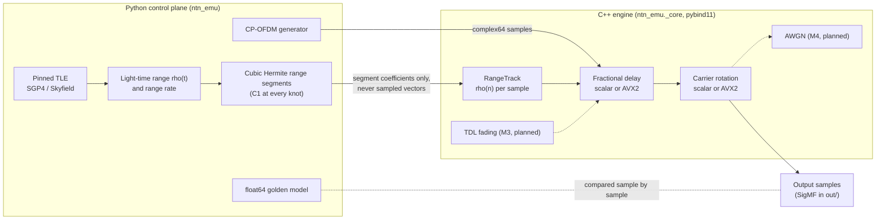
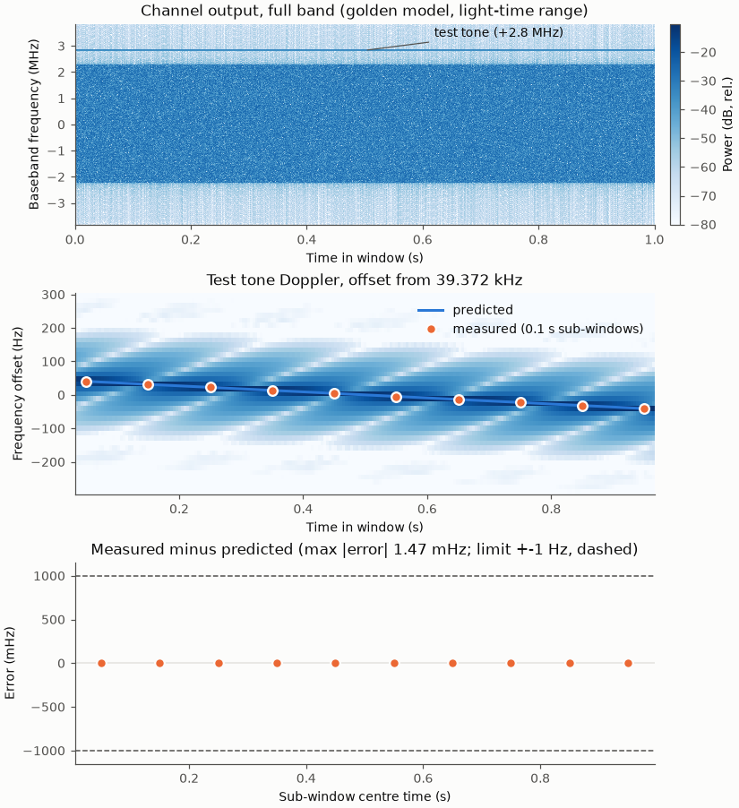
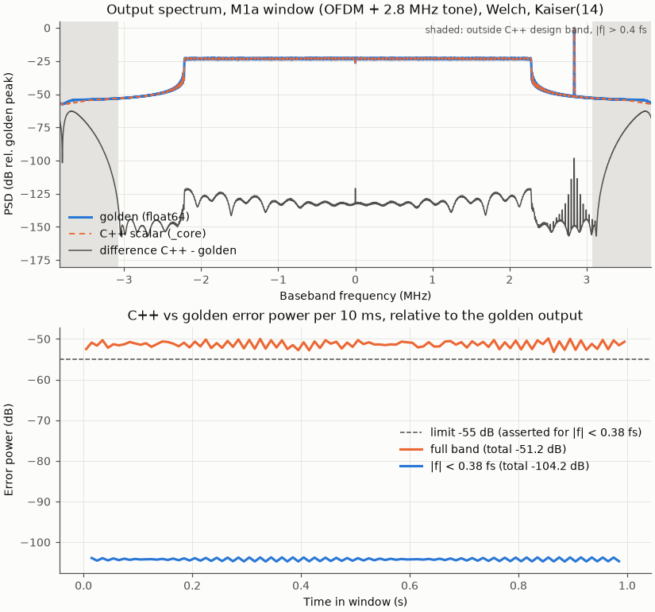
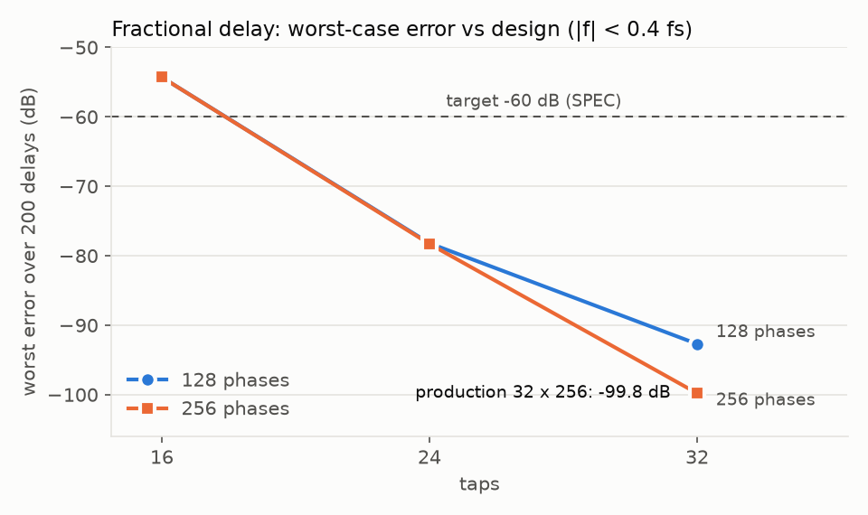

# NTN Channel Emulator

A channel emulator for the downlink service link of a low-Earth-orbit (LEO) non-terrestrial
network (NTN) at S-band. A satellite from a pinned TLE (SGP4, via Skyfield) and a fixed ground
UE define one range track rho(t); propagation delay, Doppler and carrier phase are all derived
from that single track. A Python control plane computes the geometry and hands it to a C++
engine (MSVC x64, AVX2 kernels via xsimd) as polynomial range segments; a float64 Python
"golden" model is the reference the engine is tested against. It is a portfolio project: the
emphasis is on measured, reproducible accuracy rather than on feature count. The full
specification is in [SPEC.md](SPEC.md); every measured number is in [docs/results.md](docs/results.md).

## Status
| Milestone | Scope | State |
|---|---|---|
| M1a | Python golden model, orbit geometry, range segments, waveform, SigMF | done |
| M1b | C++ scalar engine, pybind11 module `ntn_emu._core` | done |
| M2 | Final fractional-delay design, AVX2 kernels, benchmarks | done |
| M3 | NTN tapped-delay-line fading | planned |
| M4 | Receiver harness (synchronisation, EVM) | planned |
| M5 | Cross-checks, final documentation | planned |

## Scope labels
- **Link**: S-band LEO, service-link **downlink only**. No uplink, feeder link or timing advance.
- **Waveform**: NR-numerology CP-OFDM. It is **not NR-compliant**: NR PSS, comb pilots and random
  QPSK/16QAM data; no SSS, PBCH or LDPC.
- **Channel**: the **geometric stage only** (time-varying delay, Doppler and carrier phase from
  the range track). There is **no fading and no noise yet**: tapped-delay-line fading is M3, AWGN
  is M4.
- **Accuracy is specified for |f| < 0.4 fs** (the fractional-delay design band).
- **Platform**: Windows, MSVC x64 only. There is **no runtime fallback**: the engine requires a CPU
  with AVX2, FMA3, BMI1 and BMI2. Without them, `import ntn_emu._core` raises an ImportError that
  lists the missing features. The scalar kernels exist as a test oracle and benchmark baseline,
  not as a fallback path.
- **Not modelled**: path loss, link budget, antennas and beams, atmospheric and ionospheric effects.

## Architecture

Delay and carrier phase both come from the same rho(n); Doppler is never applied separately.
Phase is evaluated in float64 from the segment polynomial and wrapped before the float32
rotation, so it does not accumulate error over long runs.

### Design note: Doppler on a wideband signal
Doppler is applied by delaying the baseband signal by the time-varying range delay and rotating
the carrier phase. Each frequency component therefore gets a Doppler shift proportional to its
own RF frequency, f_c + f, not to the carrier alone. A test tone at +2.8 MHz in the M1a demo is
shifted by -(f_c + f_tone)·rho_dot/c, about 55 Hz more than the carrier Doppler -f_c·rho_dot/c
(+54.9865 to +55.1002 Hz measured over the ten sub-windows; results.md lines 138-157, M1a ›
End-to-end demo). That is why the demos predict -(f_c + f_tone)·rho_dot/c.

## Results
Headline numbers, copied from [docs/results.md](docs/results.md) (section given in each row).
Benchmarks: AMD Ryzen 5 5500U laptop, single-threaded; throughput is reported, not pass/fail.

| Quantity | Measured | Limit | results.md section |
|---|---|---|---|
| Fractional delay, production design 32 taps x 256 phases: worst error over 200 delays, band-limited noise | -99.8 dB | -60 dB | M2 › Fractional-delay design sweep |
| Slip continuity, worst +-64-sample window around a slip (realistic -23.35 ppm ramp, 23 slips) | -108.7 dB | -60 dB | M2 › Acceptance tests 1-2 |
| C++ AVX2 engine vs float64 golden model, real pass (0.1 s / 1.0 s window) | -105.48 dB / -106.25 dB | -55 dB | M2 › Acceptance test 4 |
| AVX2 vs scalar kernels: fractional delay / rotator (worst over lengths 0..4097) | -136.4 dB / -146.0 dB | -100 dB | M2 › Acceptance test 3 |
| Vectorised float32 sincos, every float in [-pi_f, pi_f] (2157060024 arguments): max \|e^ja error\| | 9.337e-08 | 1e-6 (derived) | M2 › Vectorised sincos accuracy |
| Carrier phase error on the AVX2 path, N = 10000000 samples, no drift | 2.117e-07 rad | 2e-6 rad | M2 › M1a closed-form tests on both kernels |
| Doppler of a test tone on a real pass, AVX2 pipeline, max \|measured - predicted\| | 0.0015 Hz | 1 Hz | M2 › End-to-end demo |
| AVX2 pipeline, block sizes 1 and 7 vs 4096 | 0 of 400023 samples differ | -120 dB | M2 › Acceptance test 4 |
| Throughput, scalar → AVX2: fractional delay / rotator / geometric channel (Msps) | 12.30 → 80.17 / 69.53 → 265.32 / 10.26 → 55.18 | not pass/fail | M2 › Benchmarks › Per stage |
| Full chain (geometric stage only) at fs 7.68 Msps: scalar / AVX2 | 10.24 Msps (real-time factor 1.33) / 55.02 Msps (7.16) | not pass/fail | M2 › Benchmarks › Full chain |
| Full chain (geometric stage only) at fs 30.72 Msps: scalar / AVX2 | 10.27 Msps (real-time factor 0.33) / 55.02 Msps (1.79) | not pass/fail | M2 › Benchmarks › Full chain |

Real-time factor = Msps / fs; the scalar path is slower than real time at 30.72 Msps.
The 7.68 and 30.72 Msps full-chain rows measure the same engine; only the real-time target differs.

## Figures


*M1a: spectrogram and measured vs predicted Doppler of a test tone through the golden model
(results.md › M1a › End-to-end demo).*



*M1b: C++ output spectrum overlaid on the golden model's, with their difference and the error
power per 10 ms (results.md › M1b › End-to-end demo).*



*M2: worst-case fractional-delay error vs tap count for 128 and 256 phases; the production design
is 32 taps x 256 phases (results.md › M2 › Fractional-delay design sweep).*

## Build and test
Requires a CPU with AVX2, FMA3, BMI1 and BMI2.

Prerequisites (tested versions in results.md › M2 › Toolchain and dependencies):
- Windows 10/11 x64 with Visual Studio Build Tools providing the MSVC x64 C++ compiler
  (tested: MSVC 19.50.35724.0).
- CMake >= 3.25 and Ninja on PATH. The tested setup uses standalone installs
  (tested: CMake 4.3.0-rc1, Ninja 1.13.2).
- Python 3.11 (x64), which the extension module is built against (tested: 3.11.0). The commands
  below use the `py` launcher, which the python.org installer installs; without it, replace
  `py -3.11` with the path to your Python 3.11 `python.exe`.
- Git. The C++ dependencies (GoogleTest, xsimd, Google Benchmark) are fetched by CMake at pinned
  tags (v1.17.0, 13.2.0, v1.9.4).

Python environment, from the repo root in PowerShell. The extension is installed with
`--no-build-isolation`, so its build requirements must be installed first:
```powershell
py -3.11 -m venv .venv
.\.venv\Scripts\python.exe -m pip install --upgrade pip
.\.venv\Scripts\python.exe -m pip install numpy scipy skyfield pytest scikit-build-core pybind11
.\.venv\Scripts\python.exe -m pip install matplotlib   # optional: demos and figures only
```
(tested: numpy 2.4.6, scipy 1.17.1, skyfield 1.55, pybind11 3.1.0, scikit_build_core 1.1.1)

Build and test, from the repo root in PowerShell. The MSVC environment only exists inside the
`cmd /c` call, so configure, build and ctest all run inside it:
```powershell
# Put vswhere on PATH (VsDevCmd.bat also calls it) and find the Build Tools
$env:PATH = "${env:ProgramFiles(x86)}\Microsoft Visual Studio\Installer;$env:PATH"
$vs = vswhere -latest -products * -requires Microsoft.VisualStudio.Component.VC.Tools.x86.x64 -property installationPath

# Configure + build (Release, Ninja, x64, 2 parallel jobs)
cmd /c "`"$vs\Common7\Tools\VsDevCmd.bat`" -arch=amd64 -host_arch=amd64 -no_logo && cmake -S . -B build -G Ninja -DCMAKE_BUILD_TYPE=Release && cmake --build build -j 2"

# Sanity check: must print "Pointer size: 64 bit"
.\build\hello.exe

# C++ tests (fast suite)
cmd /c "`"$vs\Common7\Tools\VsDevCmd.bat`" -arch=amd64 -host_arch=amd64 -no_logo && ctest --test-dir build --output-on-failure"

# Python extension ntn_emu._core (editable install, same MSVC environment)
cmd /c "`"$vs\Common7\Tools\VsDevCmd.bat`" -arch=amd64 -host_arch=amd64 -no_logo && set `"CMAKE_BUILD_PARALLEL_LEVEL=2`" && .\.venv\Scripts\python.exe -m pip install -e . --no-build-isolation"

# Python tests (fast suite; needs the _core install above)
.\.venv\Scripts\python.exe -m pytest python/tests
```
- Slow C++ variants: append `` && set `"NTN_SLOW=1`" && ctest --test-dir build -L slow --output-on-failure ``
  inside the same `cmd /c` string. Without `NTN_SLOW=1` they report Skipped.
- Slow Python variants: `.\.venv\Scripts\python.exe -m pytest python/tests -m slow`.
- Benchmarks (Release only): configure with `-DNTN_BUILD_BENCH=ON`, build, then
  `.\.venv\Scripts\python.exe scripts\bench_m2.py`. It records the machine, clock and power state
  and warns if the laptop is on battery or not in a best-performance power mode.

## Validation
- **Closed-form tests, not snapshots.** Expected values come from closed forms: the exact phase
  of a linear range, the FFT-domain delay of periodic band-limited noise, exact integer shifts
  (bit-exact), the instantaneous frequency of a cubic range, and the ideal delayed value of a
  sum of tones across integer-sample slips. No expected value is taken from the implementation's
  own output.
- **float64 golden model.** An independent Python model (windowed-sinc delay evaluated directly
  at the exact delay of each sample) is the reference for the C++ engine on a real pass. It was
  frozen at the `golden-v1` tag once its own closed-form tests passed.
- **Exhaustive sincos check.** The AVX2 rotator's vectorised float32 sincos is checked against
  float64 on every float32 in its argument range (2157060024 values).
- **Scalar oracle and instruction-set checks.** The AVX2 kernels are tested against the scalar
  kernels on odd lengths, tails, misaligned buffers and NaN sentinels next to the allowed read
  range. The scalar kernels are a separate target built without `/arch:AVX2`;
  `scripts/check_isa.py` verifies from the object files that they contain no AVX code, and
  `scripts/check_fma.py` shows that MSVC does not contract a*b + c into FMA under `/fp:precise`.
- **Suites.** Fast suites at the M2 record: ctest 95 tests passed, pytest 127 passed; slow suites
  with full counts are run at each milestone gate (results.md › M2 › Test suites).

## Limitations
- **Accuracy is specified for |f| < 0.4 fs.** Unshaped OFDM, which leaks power towards Nyquist,
  shows a full-band error of -51.24 dB (results.md › M1b › End-to-end demo).
- **Geometric stage only.** No fading, no noise and no receiver yet (M3, M4); the full-chain
  throughput above will drop when they are added.
- **The SGP4 range track has micrometre-level steps.** The SGP4 Kepler solver stops at a fixed
  tolerance, so range can jump by up to +6.29 um, i.e. 2.6e-04 rad of carrier phase
  (results.md › M1a › SGP4 track properties).
- **Doppler is not taken from SGP4 velocity.** SGP4's velocity differs from the derivative of its
  own position by up to 1.08e-02 m/s, so the range rate is derived from the position-based track.
- **One machine, one compiler.** Windows/MSVC x64 only, with no runtime fallback for CPUs without
  AVX2, FMA3, BMI1 or BMI2. Benchmarks come from a single laptop, single-threaded.
- **Short windows.** Captures are short windows of a pass; full passes are possible but are not
  stored by default.

## How this was built
I designed, specified and reviewed this project; it was implemented with Claude Code. Every
number in this README is reproducible from [docs/results.md](docs/results.md), which records the
command and commit behind each measurement.

License: see [LICENSE](LICENSE).
